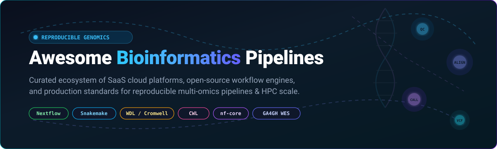

# 🧬 Awesome Bioinformatics Pipelines 

**A curated, production-ready directory of cloud SaaS genomics platforms, workflow orchestrators, and open-source bioinformatics pipelines.**

  
  
  
  
  
  

*Focused on Reproducible Genomic Workflows, High-Performance Computing (HPC), Cloud Portability & Community-Curated Standards (Nextflow, Snakemake, WDL, CWL, GA4GH).*

**Last updated: October 2026**

---

## 📖 Overview & SEO Summary

**Awesome Bioinformatics Pipelines** is a comprehensive directory covering leading **SaaS biomedical cloud platforms**, **genomics workflow execution engines**, and battle-tested **open-source secondary analysis tools**. Designed for bioinformaticians, computational biologists, genomics software engineers, and research institutions, this list tracks scalable, reproducible solutions for Next-Generation Sequencing (NGS), whole-genome sequencing (WGS), whole-exome sequencing (WES), RNA-seq, variant calling, single-cell genomics, and multi-omics big data processing across local workstations, HPC clusters (Slurm, PBS, LSF, SGE), and hybrid clouds (AWS, GCP, Azure).

---

## 📑 Table of Contents

- [📊 Sector Overview & Market Dynamics](#-sector-overview--market-dynamics)
- [☁️ SaaS / Hosted Platforms](#️-saas--hosted-platforms)
- [💻 Open-Source GitHub Projects](#-open-source-github-projects)
- [🤝 How to Contribute](#-how-to-contribute)
- [💖 Support & Sponsorship](#-support--sponsorship)
- [📈 Star History](#-star-history)
- [⚠️ Disclaimer](#️-disclaimer)

---

## 📊 Sector Overview & Market Dynamics

The global bioinformatics and cloud genomics market is valued at approximately **$20B–$23.5B in 2025–2026** and projected to exceed **$63B–$118B by the mid-2030s** (~15%–21% CAGR), driven by exponential drops in sequencing costs, clinical multi-omics adoption, and AI-accelerated drug discovery. The sector remains **moderately fragmented**: sequencing hardware and primary upstream data generation are heavily concentrated around dominant players (e.g., Illumina), but downstream secondary workflow orchestration, tertiary analysis, and clinical interpretation remain fragmented across diverse proprietary SaaS suites, academic clouds, and open-source orchestration standards.

---

## ☁️ SaaS / Hosted Platforms

| Platform | Company Size (Valuation / Revenue) | Pricing | Free Tier Limit | Description |
| :--- | :--- | :--- | :--- | :--- |
| **[Illumina BaseSpace](https://www.illumina.com/products/by-type/informatics-products/basespace-sequence-hub.html)** | ~$40B–$41.5B Market Cap / $4.34B–$4.6B Annual Revenue | Starting at $0/mo (Pay-As-You-Go, $1/BIC credit consumption for compute/DRAGEN analysis) | 30-day free trial with 1 TB cloud storage and 100–250 promotional BioInsight credits (BICs) | Illumina's cloud platform for sequencing data analysis, storage, and sharing with native sequencer upload. |
| **[DNAnexus](https://www.dnanexus.com/)** | ~$600M Valuation / ~$80M–$85M Annual Revenue | Starting at $450,000/yr (Base enterprise platform contract list on AWS Marketplace; variable compute units from $50/unit) | Free base account registration; pilot programs (e.g. UK Biobank RAP) include £40 initial credit valid for 90 days (no open compute free tier) | Governed cloud data workspace for omics, phenotypes, multi-language pipelines (CWL, WDL, Nextflow), and clinical analytics. |
| **[Seven Bridges](https://www.sevenbridges.com/)** | ~$130M Standalone Valuation / €27M Annual Revenue (Velsera parent) | Starting at $0 platform fee on NCI Cancer Genomics Cloud (pure pass-through cloud compute/storage rates, e.g. AWS EC2/S3 costs) | $300 free cloud compute and storage credits upon registration via NCI Cancer Genomics Cloud (covers ~40–50 analyses) | CWL-centered commercial & cancer research platform hosting NCI CGC with 850+ curated workflows and multi-cloud execution. |
| **[Nextflow Tower (Seqera Platform)](https://seqera.io/)** | ~$50M–$100M Valuation / ~$9.5M–$18.5M Annual Revenue | Starting at $0/mo (Cloud Basic); Pro/Enterprise starting tiers require custom team quotes | Free forever plan with up to 3 users, 3 concurrent pipeline runs, 250 run histories, 100 datasets, and 100 GB/mo Fusion storage | Official Nextflow management and control plane for collaborative pipeline monitoring, access control, and multi-cloud/HPC execution. |
| **[BC Platforms](https://www.bcplatforms.com/)** | ~$20M+ Growth Funding / ~$25M Annual Revenue | Starting at $48,000/yr (Base 12-month BC Mosaic instance contract on AWS Marketplace) | No perpetual free tier or public self-serve trial (private pilot/demo access provided upon sales qualification) | Genomics data management, biobank governance, and cohort discovery platform for clinical interpretation and precision medicine. |
| **[LifeOmic](https://lifeomic.com/)** | Acquired by Fountain Life / ~$3.5M Annual Revenue | Starting at $17/mo to $40/mo (Consumer/clinician LIFE Ascent tier; enterprise PHC billed by custom storage and compute volume) | Free forever plan for basic consumer health tracking; 7-day free trial for premium clinical mobile apps (enterprise PHC requires custom pilot demo) | Precision health cloud with genomics data management, clinical EHR integration, and longevity diagnostics. |
| **[Terra.bio](https://terra.bio/)** | Non-profit / Consortium-backed (Broad Institute, Microsoft & Verily) | $0 platform fee (100% direct pass-through for Google Cloud or Azure compute, disk, and bucket storage) | $300 in free Google Cloud credits for new users with up to 5 exploratory active workspaces (eligible for NIH STRIDES credits) | Biomedical analysis platform with Jupyter notebooks, WDL/Cromwell execution, and large collaborative cancer/consortia workspaces. |
| **[Galaxy Cloud](https://usegalaxy.org/)** | Academic / Consortia funded (ELIXIR, NIH, NSF) | $0/mo (Open-access community-hosted public cloud servers) | Free forever with 250 GB storage quota per user (expandable to 500 GB for verified ELIXIR researchers; 50 GB per dataset limit) | Accessible web-based GUI workflow system with a massive open tool catalog and zero command-line prerequisite. |
| **[Cromwell Cloud](https://cromwell.readthedocs.io/)** | Open-source foundation (Broad Institute) / Commercial integrations | $0 platform fee (Managed execution via Terra or self-deployed on cloud compute pass-through) | Included within Terra.bio's $300 free trial cloud credit allocation | Broad Institute's WDL execution engine optimized for GATK4 best-practice pipelines and scalable workflow orchestration. |
| **[Arvados](https://arvados.org/)** | Commercialized by Curii Corp / Open-source foundation | Starting at $0 software license (Open-source self-hosted; enterprise managed cluster support via Curii contracts) | Free forever for self-hosted instances (all open-source code under AGPL-3.0); commercial managed clusters require custom evaluation agreement | Open-source biomedical big-data platform running CWL workflows with Git-based tracking and Keep content-addressable storage. |

---

## 💻 Open-Source GitHub Projects

*All open-source repositories are ranked in descending order by GitHub stars. Star counts update dynamically.*

1. **[Pachyderm](https://github.com/pachyderm/pachyderm)**   
   **Data-lineage and pipelining engine for reproducible data science** (Apache-2.0). Provides version-controlled, containerized data pipelines with Git-like data primitives, automated incremental processing, and complete data provenance tracking.

2. **[Google DeepVariant](https://github.com/google/deepvariant)**   
   **Deep-learning-based variant caller** (BSD-3-Clause). Developed by Google Health and Genomics, DeepVariant employs convolutional neural networks to call genetic variants from NGS and long-read sequencing data (PacBio, ONT) with state-of-the-art accuracy.

3. **[Nextflow](https://github.com/nextflow-io/nextflow)**   
   **Dataflow workflow engine for scalable and reproducible science** (Apache-2.0). The most widely adopted workflow management system for modern bioinformatics alongside Snakemake. Decouples pipeline logic from execution layers, running seamlessly on workstations, HPC clusters (Slurm, PBS, LSF), Kubernetes, and multi-cloud environments (AWS Batch, GCP, Azure).

4. **[Snakemake](https://github.com/snakemake/snakemake)**   
   **Python-native, rule-based workflow management system** (MIT). Enables readable, declarative pipeline creation with automatic parallelization, modular rules, conda/container virtualization, checkpointing, and execution portability across local machines and cloud schedulers.

5. **[STAR](https://github.com/alexdobin/STAR)**   
   **Ultra-fast universal RNA-seq aligner** (GPL-3.0). High-performance alignment engine capable of mapping spliced RNA-seq reads to a reference genome with high sensitivity, precision, and speed, widely integrated into transcriptomic pipelines.

6. **[GATK (Genome Analysis Toolkit)](https://github.com/broadinstitute/gatk)**   
   **Industry gold standard for variant discovery in high-throughput sequencing data** (BSD-3-Clause). Developed by the Broad Institute, GATK4 provides comprehensive best-practice workflows for germline and somatic variant calling, copy-number analysis, and quality score recalibration.

7. **[Samtools](https://github.com/samtools/samtools)**   
   **Essential utilities for manipulating high-throughput sequencing data** (MIT/BSD). Provides standard command-line tools for reading, writing, sorting, indexing, and viewing SAM, BAM, and CRAM alignment formats, fundamental to almost all genomic pipelines.

8. **[Bioconda Recipes](https://github.com/bioconda/bioconda-recipes)**   
   **The distribution channel for bioinformatics software packages** (MIT). The primary Conda repository distributing thousands of bioinformatics tools and containerized recipes utilized in automated Nextflow, Snakemake, and Galaxy pipelines.

9. **[Galaxy Project](https://github.com/galaxyproject/galaxy)**   
   **Open, web-based platform for accessible, reproducible, and collaborative biomedical research** (AFL-3). Features an intuitive graphical interface, thousands of pre-wrapped computational tools, and multi-user workflow sharing without requiring command-line knowledge.

10. **[BWA (Burrows-Wheeler Aligner)](https://github.com/lh3/bwa)**   
    **Fast and accurate short and long read aligner** (GPL-3.0). Standard sequence alignment algorithm used worldwide in primary and secondary genomic pipelines to map sequencing reads against large reference genomes (BWA-MEM).

11. **[CWL (Common Workflow Language)](https://github.com/common-workflow-language/common-workflow-language)**   
    **Open standard specification for describing data analysis workflows and command-line tools** (Apache-2.0). Focuses on platform-agnostic portability, strict containerization, and explicit inputs/outputs supported across Seven Bridges, Arvados, Toil, and CWL-Airflow.

12. **[Cromwell](https://github.com/broadinstitute/cromwell)**   
    **Broad Institute's Workflow Description Language (WDL) execution engine** (BSD-3-Clause). Powers GATK best-practice workflows, Terra.bio, and consortium-level genomics pipelines with pluggable backends for HPC clusters and cloud providers.

13. **[bcbio-nextgen](https://github.com/bcbio/bcbio-nextgen)**   
    **Validated, community-driven variant calling and RNA-seq pipelines** (MIT). The pioneering open-source automated framework for whole genome and exome variant calling, scalable across heterogeneous clusters via CWL, Toil, and Arvados.

14. **[Salmon](https://github.com/COMBINE-lab/salmon)**   
    **Ultra-fast transcript-level quantification engine** (GPL-3.0). Accurately quantifies gene expression from RNA-seq data using quasi-mapping and dual-phase optimization, an integral component of modern transcriptomics pipelines.

15. **[Toil](https://github.com/DataBiosphere/toil)**   
    **Scalable, open-source workflow engine** (Apache-2.0). Developed by UCSC Genomics Institute, Toil supports Python, CWL, and WDL workflows with elastic auto-scaling on AWS, GCP, Azure, and Kubernetes.

16. **[Manta](https://github.com/Illumina/manta)**   
    **Structural variant and indel caller for mapped sequencing reads** (GPL-3.0). Rapidly discovers structural variants and medium-sized indels from paired-end sequencing, widely embedded in clinical genomics pipelines.

17. **[Arvados](https://github.com/arvados/arvados)**   
    **Open-source platform for managing and processing biomedical big data** (AGPL-3.0). Combines CWL workflow execution, Keep content-addressable storage, and fine-grained access control for institutional genomics infrastructure.

18. **[Strelka2](https://github.com/Illumina/Strelka)**   
    **Fast somatic and germline small variant caller** (GPL-3.0). Optimized for high-throughput sequencing pipelines, accurately resolving SNVs and small indels with low computational overhead.

19. **[nf-core (tools)](https://github.com/nf-core/tools)**   
    **The companion toolkit for building community-curated Nextflow pipelines** (MIT). De facto standard framework providing 85+ validated pipelines, strict template linting, nf-test integration, and peer-reviewed best practices.

20. **[Smoove](https://github.com/brentp/smoove)**   
    **Streamlined structural variant calling workflow** (MIT). Coordinates discovery, sorting, filtering, and genotyping of structural variants using LUMPY and svtyper across cohort-scale genomes.

21. **[WARP (Broad Institute)](https://github.com/broadinstitute/warp)**   
    **WDL Analysis Research Pipelines** (BSD-3-Clause). Scientifically validated, cloud-optimized pipelines developed by the Broad Institute for large-scale consortia including the Human Cell Atlas and BRAIN Initiative.

22. **[WESkit](https://gitlab.com/one-touch-pipeline/weskit)**  
    **GA4GH Workflow Execution Service (WES) implementation** (MIT). Streamlines execution, monitoring, and documentation of Nextflow and Snakemake pipelines across enterprise research groups.

23. **[GenBoard](https://ieeexplore.ieee.org/document/11628869)**  
    **Real-time monitoring and observability platform for genomic pipelines** (IEEE 2026). Decouples pipeline monitoring through Apache Kafka, providing interactive DAGs, per-task metrics, and multi-tenant isolation.

---

## 🤝 How to Contribute

Contributions are warmly welcomed! Please follow these simple guidelines:

1. 🍴 **Fork** the repository.
2. 🌿 Create a feature branch (`git checkout -b feature/new-pipeline`).
3. 📝 Add or update entries following the established format:
   - Name and link to the official repository/product
   - GitHub stars social badge linking to `/stargazers` (for open-source tools)
   - 1–2 sentence description highlighting license, key capabilities, and use-case
4. 🚀 Submit a **Pull Request** with a clear explanation of the addition.

---

## 💖 Support & Sponsorship

If you find this curated bioinformatics ecosystem tracker helpful in your research, pipelines, or engineering workflows, please consider showing your support:

- ⭐ **Star** this repository on GitHub to help others discover it!
- 🍴 **Fork** and share it with your lab, team, and bioinformatics community.
- ☕ **Buy a Coffee & Sponsor:** Back further maintenance and curation via the [GitHub Sponsors Dashboard](https://github.com/sponsors/ishandutta2007).

Your support keeps this directory up-to-date and comprehensive for the global computational biology community!

---

## 📈 Star History

---

## ⚠️ Disclaimer

- This is a **community-curated** list — not exhaustive and not an endorsement.
- Bioinformatics pipelines handling genomic and patient data must comply with **HIPAA, GDPR, and institutional review board (IRB) requirements**. **Data residency and consent management are critical**—verify deployment regions before processing protected health information.
- **Open-source bioinformatics pipelines are mature and production-ready.** Nextflow and Snakemake account for the vast majority of new bioinformatics pipelines. nf-core provides 85+ community-curated pipelines with rigorous testing and peer review.
- **Decoupling pipeline logic from execution is the core value.** Modern workflow systems separate analytical logic ("what to run") from execution environments ("how to run")—enabling workflows to execute identically on laptops, institutional HPCs, or elastic cloud clusters.
- **Cloud costs require careful design.** Enterprise platforms (such as DNAnexus, Velsera/Seven Bridges, and BC Platforms) operate under structured master rate cards and annual cloud commitments.

---

**Made with 🧬 for bioinformaticians, computational biologists, and researchers building transparent genomic solutions.**

Let's make Bioinformatics Pipelines more open, reproducible, and accessible to all!

